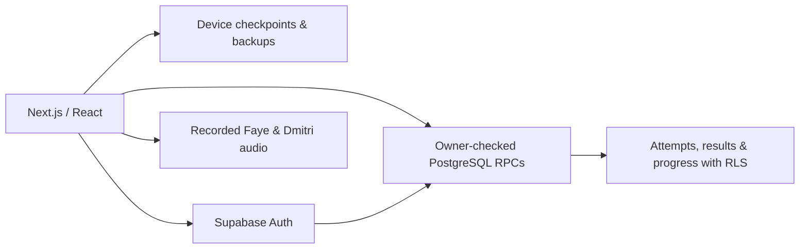

# TOEIC Path

A personal TOEIC Listening & Reading practice app for building a consistent study routine over **4, 8 or 12 weeks**. It combines original practice questions, recorded conversations, spaced mistake review and progress tracking in one study space.

**[Try the live app](https://toeic-path-next-preview.vercel.app)** · [Source code](https://github.com/nqthai37/toeic-path) · [Development & deployment](docs/DEPLOYMENT.md)

The English welcome page introduces the app beside an email/password **sign-in and sign-up** form. The sign-in page has no guest-practice shortcut.

## What you can do

- **Practice all seven parts:** 246 original questions, passages, illustrations and authored explanations. Shared conversations and passages stay together when sessions are assembled.
- **Train under a deadline:** 10 disjoint mini tests of 20 questions each, a 12-minute reading sprint and a 15-minute custom challenge. Learning mode lets you check answers as you go.
- **Listen to natural conversations:** 102 prerecorded HeyGen clips featuring **Faye and Dmitri**, including listening passages, 24 vocabulary items and voice previews. Playback supports speed adjustment without changing the voices.
- **Follow a personal routine:** choose a preparation length, target and daily study time. Daily suggestions combine due review, areas with enough first-answer evidence and new material.
- **Build recall:** mistakes return on a 1, 3 and 7-day schedule. Early repetitions do not count as spaced recall.
- **Keep your work:** resume a saved session, sign in with email and password (or an email link), synchronize account progress and export or merge backups. Guest and account data stay separate unless you explicitly import.
- **Keep your daily flame:** open your avatar to see your display name, preparation day and consecutive login streak, with one daily flame animation per account.
- **Understand your progress:** view first answers, repeated practice, spaced recall and estimated active study time separately.

## Built with

| Layer | Technology |
| --- | --- |
| Application | Next.js App Router, React, TypeScript |
| Authentication | Supabase Auth, email/password, PKCE email links, cookie-based session helpers |
| Backend | Supabase PostgreSQL, Row Level Security, owner-checked RPCs |
| Audio | Prerecorded HeyGen WAV assets with stable IDs and SHA-256 hashes |
| Hosting | Vercel |
| Validation | Node.js tests, TypeScript, production route checks, PostgreSQL tests with PGlite, GitHub Actions |

The React application owns navigation, quiz state, playback and device checkpoints. Signed-in attempts use server-side grading, revision checks and idempotent submission. An ordered answer queue retains pending choices through temporary network failures. Account changes fence off late responses from the previous session.



## Run locally

Requires **Node.js 22**.

```sh
npm ci
npm --prefix apps/web ci
npm run dev
```

Open **http://127.0.0.1:3000**. To run a production build:

```sh
npm run build
npm start
```

The deployed Supabase project's public configuration is already present. To use another project, set `NEXT_PUBLIC_SUPABASE_URL` and `NEXT_PUBLIC_SUPABASE_PUBLISHABLE_KEY` in `apps/web/.env.local`, apply the SQL migrations and seed, and configure the callback URLs. Never use a service-role key in browser code. See [deployment instructions](docs/DEPLOYMENT.md).

## Project structure

```text
apps/web/
  app/                 Next.js routes and authentication callback
  src/components/      React learning views, quiz, audio and activity tracking
  src/lib/             Shared types, storage helpers and Supabase clients
  src/generated/       Versioned content and preserved domain rules
  public/              Illustrations and recorded audio
  tests/               Migration, content and behavior tests
supabase/
  migrations/          Database schema, RLS, RPCs and additive migrations
  seed.sql             Original question and audio catalog
src/                   Authored content and original migration reference fixtures
scripts/               Content generation, validation and migration notice build
tests/                 Domain, adapter and database regression tests
docs/                  Design notes, verification and migration history
```

The production application is entirely served by **Next.js on Vercel**. GitHub Pages is retained only as a migration notice and local history exporter for learners arriving from the former address. The previous static application remains in source for regression checks; it is not loaded by the React app.

## Check the project

```sh
npm test
npm run migration:check
npm run web:test
npm run build
npm run web:typecheck
npm run web:test:routes
```

Tests cover content identities and audio integrity, complete-group selection, active time, import provenance, spaced review, queued writes, revision conflicts, private answer keys, ownership, RLS, server grading and duplicate submission. The deployment guide lists the additional legacy parity and migration-notice checks.

## Scope

TOEIC Path is an independent educational portfolio project. It is **not affiliated with ETS**, does not contain official test items and does not provide a calibrated TOEIC score prediction. The mini tests are shorter than the real exam. Active time is an engagement estimate; skill labels and question difficulty are not fully calibrated. Guest answer keys are part of the public learning content, so the app is designed for self-study rather than secure examinations.

AI explanations and a React Native client are outside this release. The repository documents the current implementation and verification limits in [deployment notes](docs/DEPLOYMENT.md) and [migration status](docs/migration/STATUS.md).
